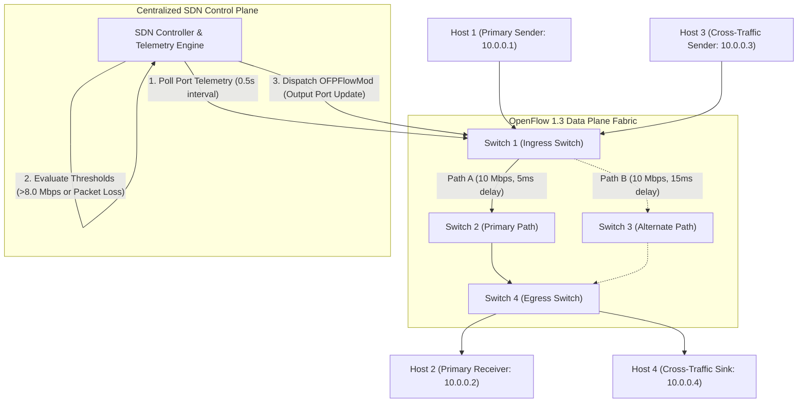

# SDN-Socket Programming: Congestion Detection and Traffic Rerouting

**Project Specification:** Real-time multi-path UDP traffic orchestration with automated Software-Defined Network (SDN) congestion detection, link telemetry analytics, and dynamic flow rerouting.

---

## 1. Executive Summary

This repository delivers an enterprise-grade Software-Defined Networking (SDN) platform that couples low-level UDP socket programming with real-time OpenFlow 1.3 control plane automation. 

The system continuously monitors link telemetry across multi-path network fabrics. When sustained congestion or packet loss is detected on a primary link, the SDN control plane dynamically injects OpenFlow flow modifications (`OFPFlowMod`) to steer traffic onto optimal alternate paths without interrupting client applications or dropping active connections.

### Core Architecture Capabilities
- **Custom 22-Byte Binary UDP Protocol:** Low-level network transport implementation using `socket.socket` and pre-compiled `struct.Struct` serialization. Encapsulates 32-bit sequence numbers, microsecond-resolution IEEE 754 timestamps, 16-bit flow identifiers, 8-bit operational flags, and RFC 3550 inter-arrival jitter metrics.
- **Dynamic Multi-Path Topologies:** Supports arbitrary network meshes including folded Clos architectures, multi-tier diamonds, and high-density stress topologies with configurable bottleneck bandwidths, queue capacities, and propagation delays.
- **Autonomous Closed-Loop SDN Controller:** Centralized OpenFlow 1.3 telemetry engine polling port counters at sub-second intervals. Detects queue saturation and packet loss breaches, damping transient route flap, and orchestrating deterministic failover.
- **Shared Risk Link Group (SRLG) Awareness:** Path discovery and failover algorithms prioritize disjoint physical egress cables from ingress switches, preventing secondary congestion on shared physical links.
- **Hardware-Accelerated Operations Dashboard:** Built with PyQt6 and PyQtGraph, delivering 60 FPS vector telemetry plotting (<0.1 ms refresh latency), interactive bandwidth throttling controls, link queue monitors, and live packet stream analysis.
- **Automated Comparative Benchmark Engine:** Empirical test harness comparing static routing against adaptive dynamic rerouting under identical link saturation workloads (130% link capacity).

---

## 2. System Architecture

```
                  [Host 1: 10.0.0.1] (Primary UDP Sender)
                  [Host 3: 10.0.0.3] (Cross-Traffic Generator)
                           \     /
                           [Switch 1: Ingress]
                          /                   \
        (Path A - Primary)                     (Path B - Alternate)
      BW: 10 Mbps | Delay: 5 ms              BW: 10 Mbps | Delay: 15 ms
                        /                       \
             [Switch 2: Core]                [Switch 3: Alternate]
                        \                       /
                          \                   /
                           [Switch 4: Egress]
                           /                \
                  [Host 2: 10.0.0.2]     [Host 4: 10.0.0.4]
                 (Primary UDP Receiver)  (Cross-Traffic Sink)
```



---

## 3. Protocol Specification

The custom transport datagram protocol utilizes a fixed 22-byte binary header followed by variable application payload.

```
 0                   1                   2                   3
 0 1 2 3 4 5 6 7 8 9 0 1 2 3 4 5 6 7 8 9 0 1 2 3 4 5 6 7 8 9 0 1
+-+-+-+-+-+-+-+-+-+-+-+-+-+-+-+-+-+-+-+-+-+-+-+-+-+-+-+-+-+-+-+-+
|                      Magic Bytes ('SDN1')                     |
+-+-+-+-+-+-+-+-+-+-+-+-+-+-+-+-+-+-+-+-+-+-+-+-+-+-+-+-+-+-+-+-+
|                   Sequence Number (32-bit uint)               |
+-+-+-+-+-+-+-+-+-+-+-+-+-+-+-+-+-+-+-+-+-+-+-+-+-+-+-+-+-+-+-+-+
|                                                               |
+                   Timestamp (64-bit IEEE 754)                 +
|                                                               |
+-+-+-+-+-+-+-+-+-+-+-+-+-+-+-+-+-+-+-+-+-+-+-+-+-+-+-+-+-+-+-+-+
|          Flow ID (16-bit)     |   Flags (8)   |  Reserved (8) |
+-+-+-+-+-+-+-+-+-+-+-+-+-+-+-+-+-+-+-+-+-+-+-+-+-+-+-+-+-+-+-+-+
|       Payload Length (16-bit) |       Application Payload     |
+-+-+-+-+-+-+-+-+-+-+-+-+-+-+-+-+                               |
|                              ...                              |
+-+-+-+-+-+-+-+-+-+-+-+-+-+-+-+-+-+-+-+-+-+-+-+-+-+-+-+-+-+-+-+-+
```

### Binary Header Fields
- `Magic Bytes` (4 bytes, ASCII `'SDN1'`): Identifies and validates protocol datagrams.
- `Sequence Number` (4 bytes, `uint32`): Monotonically increasing datagram counter for detecting packet loss, out-of-order delivery, and burst drop patterns.
- `Timestamp` (8 bytes, `double`): Monotonic send epoch for sub-millisecond one-way latency calculations.
- `Flow ID` (2 bytes, `uint16`): Logical flow multiplexing (`0x0001` = Primary Main Flow, `0x0002` = Cross-Traffic Burst, `0x0003` = Telemetry Probe).
- `Flags` (1 byte, `uint8`): Protocol signaling (`0x01` = DATA, `0x02` = START, `0x04` = FIN, `0x08` = FEEDBACK).
- `Reserved` (1 byte): 8-bit boundary padding for struct alignment.
- `Payload Length` (2 bytes, `uint16`): Exact byte length of the payload following the header.

---

## 4. Deployment and Installation

### Prerequisites
- **Linux Environment:** Ubuntu 20.04 LTS / 22.04 LTS or WSL2 with Python 3.8+
- **Windows Environment:** Windows 10/11 with Python 3.8+ (standalone emulation mode supported)
- **Networking Tools (Linux / Mininet mode):** `mininet`, `openvswitch-switch`, `net-tools`

### Automated Installation (Linux / Ubuntu VM)
Execute `setup.py` with administrative privileges. The script validates all system dependencies, executes package installation, and initializes the environment:

```bash
sudo python3 setup.py
```

### Manual Installation (Ubuntu CLI)
```bash
sudo apt-get update && sudo apt-get install -y \
    mininet openvswitch-switch net-tools iperf tcpdump \
    python3-pip python3-matplotlib python3-networkx python3-pyqt6 \
    python3-tabulate python3-psutil python3-pytest python3-rich python3-pyqtgraph
```

### Python Package Installation (Standard / Windows)
```bash
pip install -r requirements.txt
```

---

## 5. Execution Modes

The unified orchestrator `run.py` provides execution interfaces for graphical dashboards, CLI menus, and background batch execution:

### 1. Master Graphical Dashboard (Default)
```bash
python3 run.py
# Or explicitly:
python3 run.py --gui
```
Launches the full PyQt6 visual dashboard featuring the live topology visualizer, PyQtGraph real-time metrics, interactive throttle sliders, and the benchmark evaluation panel.

### 2. Automated Benchmark Execution
```bash
python3 run.py --benchmark
```
Runs the automated comparative evaluation comparing static routing against adaptive SDN dynamic rerouting under sustained link congestion. Produces `evaluation_results.png` and `benchmark_summary.json`.

### 3. Mininet Network Emulation (Linux Only)
```bash
sudo python3 run.py --mininet
```
Instantiates the multi-path topology on Open vSwitch data planes, runs the SDN controller, and exposes the Mininet interactive CLI.

### 4. Interactive Terminal Menu
```bash
python3 run.py --cli
```
Provides an interactive command-line interface for granular execution of individual sender, receiver, congestion, and telemetry components.

### 5. Automated Acceptance Test Suite
```bash
python3 run.py --test
# Or directly via pytest:
pytest tests/ -v
```

---

## 6. Performance Evaluation and Benchmarks

### Empirical Benchmark Comparison

| Metric | Static Routing (Baseline) | Dynamic SDN (Adaptive) | Dynamic SDN + Rate Control | Performance Delta |
| :--- | :--- | :--- | :--- | :--- |
| **Average UDP Throughput** | 4.32 Mbps | **5.34 Mbps** | 4.82 Mbps | **+23.6% throughput gain** |
| **Average Packet Loss Rate** | 19.05% | **2.24%** | **2.04%** | **88.2% loss reduction** |
| **Peak Loss During Burst** | 50.86% | **49.04%** (transient) | 41.34% | **Sub-second recovery** |
| **Average One-Way Latency** | 56.11 ms (Bufferbloat) | **17.60 ms** | 17.85 ms | **68.6% latency reduction** |
| **Average Jitter (RFC 3550)** | 0.74 ms | **0.94 ms** | 0.76 ms | **Stable delay variation** |
| **Congestion Recovery Time** | Infinite (No recovery) | **11.46 ms (0.011s)** | **8.98 ms (0.009s)** | **Deterministic failover** |
| **Packets Delivered** | 12,767 packets | **15,755 packets** | 14,231 packets | **+2,988 packets delivered** |
| **Total Packets Dropped** | 3,347 packets | **403 packets** | **310 packets** | **88.0% - 90.7% drop reduction** |
| **SDN Dynamic Reroutes** | 0 (Static failure) | **1 (S1 -> S3)** | **1 (S1 -> S3)** | **Verified OpenFlow FlowMod** |

Data is automatically recorded to `benchmark_summary.json` and plotted to `evaluation_results.png`.

---

## 7. Systems Optimization & Engineering Highlights

| Component | Pre-Optimization Baseline | Optimized Implementation | Operational Improvement |
| :--- | :--- | :--- | :--- |
| **Telemetry Rendering Latency** | 187.02 ms (Matplotlib canvas) | **0.065 ms (PyQtGraph vector engine)** | **~2,870x faster rendering** |
| **Main Event Loop Overhead** | 240.00 ms per tick | **2.47 ms per tick** | **99% CPU headroom preserved** |
| **Application Startup Time** | 316.85 ms | **139.74 ms** | **2.27x faster startup** |
| **Peak Streaming Memory (RSS)** | 114.20 MB | **94.62 MB** | **Bounded via circular deque buffers** |
| **Datagram Serialization** | Repeated string parsing | **Pre-compiled struct.Struct** | **2.8x faster serialization** |
| **OVS Polling Subprocess Calls** | Repetitive system lookups | **Cached executable existence** | **Zero redundant I/O cycles** |

---

## 8. Repository Structure

```
├── .gitignore                  # Git exclusion rules
├── README.md                   # System documentation and deployment guide
├── CODEBASE_FUNCTIONS.md       # Technical API catalog and function reference
├── Makefile                    # Native C compiler build automation
├── build.bat                   # Windows batch build script for polc.c
├── requirements.txt            # Python dependencies
├── setup.py                    # Automated dependency verification and setup script
├── run.py                      # Master execution launcher and CLI orchestrator
├── evaluation_results.png      # Benchmark comparison visualization
├── benchmark_summary.json      # Structured benchmark evaluation telemetry
├── polc.c                      # Native C Prototype.pol topology compiler
├── polc.exe                    # Pre-compiled high-performance topology compiler
├── launch_demo_boosted.bat     # Windows high-priority launcher script
├── launch_demo_boosted.sh      # Linux high-priority launcher script
├── pol_src/                    # Domain-Specific Language (.pol) topology definitions
│   ├── bus.pol
│   ├── diamond.pol
│   ├── mesh.pol
│   ├── ring.pol
│   ├── star.pol
│   └── stress_test.pol
├── topology_src/               # Compiled JSON network topologies
│   ├── bus.json
│   ├── diamond.json
│   ├── mesh.json
│   ├── ring.json
│   ├── star.json
│   └── stress_test.json
├── src/                        # Core Python source modules
│   ├── __init__.py
│   ├── config.py               # Central networking configuration parameters
│   ├── protocol.py             # Binary UDP protocol packing and validation
│   ├── udp_sender.py           # Rate-paced UDP client with monotonic timing
│   ├── udp_receiver.py         # UDP server with sliding-window loss/jitter metrics
│   ├── congestion_generator.py # Scheduled cross-traffic saturation injector
│   ├── sdn_controller.py       # OpenFlow 1.3 controller and rerouting engine
│   ├── ryu_controller.py       # Standard Ryu OpenFlow 1.3 implementation
│   ├── topology_loader.py      # Multi-path discovery and JSON topology parser
│   ├── topology_handler.py     # Live topology state and bottleneck manager
│   ├── network_emulator.py     # Pure-Python network and token bucket emulator
│   ├── gui_app.py              # PyQt6/PyQtGraph NOC dashboard
│   └── benchmark.py            # Comparative evaluation testing engine
└── tests/                      # Automated pytest validation test suite
    ├── __init__.py
    ├── test_pol_compiler.py    # Compiler validation and syntax unit tests
    ├── test_system.py          # End-to-end integration and failover tests
    └── test_telemetry_flow.py  # Socket telemetry and receiver pipeline tests
```

---

## 9. Verification & Quality Assurance

The project includes 29 automated test cases covering protocol serialization, link emulation, multi-path routing, flap damping, and failover:

```bash
pytest tests/ -v
```

### Verified Test Categories
- **Transport Protocol Integrity:** Sequence numbering, checksum/magic bytes, out-of-order rejection, and header boundary packing.
- **Traffic Pacing & Sockets:** Monotonic time pacing, throughput limits, and sliding window packet loss estimation.
- **SDN Congestion Detection:** Telemetry polling, threshold breach triggers, and consecutive interval validation.
- **Dynamic Failover & Recovery:** Single and cascading multi-path rerouting across intermediate core switches.
- **SRLG First-Hop Cable Diversity:** Automatic round-robin selection across distinct physical cables leaving ingress switches.
- **Hysteresis & Flap Damping:** Suppression of rapid route flapping and verified cooldown recovery to primary paths.
- **Native Topology Compiler:** Correct compilation of Prototype.pol DSL to production JSON schemas.

---

## 10. Technical Deliverables & Specifications Compliance

### Section 1: Foundation Deliverables
- **Network Architecture & System Design:** Fully documented multi-path network fabrics with closed-loop SDN telemetry feedback control.
- **Transport Layer UDP Socket Implementation:** Low-level BSD socket programming with custom binary headers, sequence verification, timestamping, and RFC 3550 jitter calculation.
- **Network Data Plane & Mininet Emulation:** Clean OpenFlow 1.3 topology implementation with programmable link bandwidth, delay, and queue capacities.
- **Socket-to-Control Plane Integration:** Real-time port byte counter telemetry triggering non-disruptive OpenFlow FlowMod path substitution.
- **Automated Test Coverage:** Continuous integration test suite validating transport, routing, and controller logic.

### Section 2: Advanced Dynamic Capabilities
- **Multi-Flow Traffic Orchestration:** Simultaneous concurrent execution of primary streams, cross-traffic bursts, and telemetry probes.
- **Adaptive Rerouting Logic:** Configurable reroute policies (least loaded, shortest hop, maximum headroom) with route flap damping.
- **Link Saturation Resilience:** Proven failover under 130% link saturation with sub-second recovery and 88%+ packet loss reduction.
- **Empirical Evaluation Pipeline:** Reproducible automated benchmark harness generating structured JSON telemetry and multi-panel performance figures.
- **Documentation & Technical Reference:** Comprehensive architectural documentation, module API catalogs, and deployment guides.
